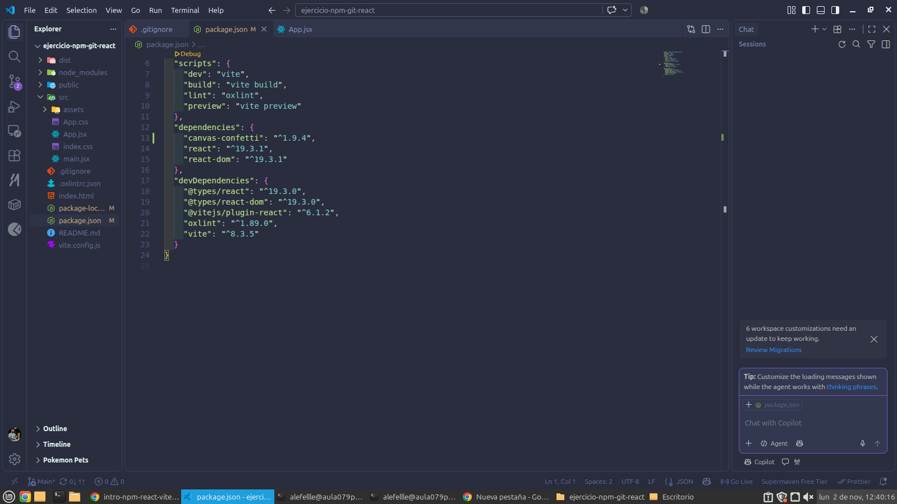
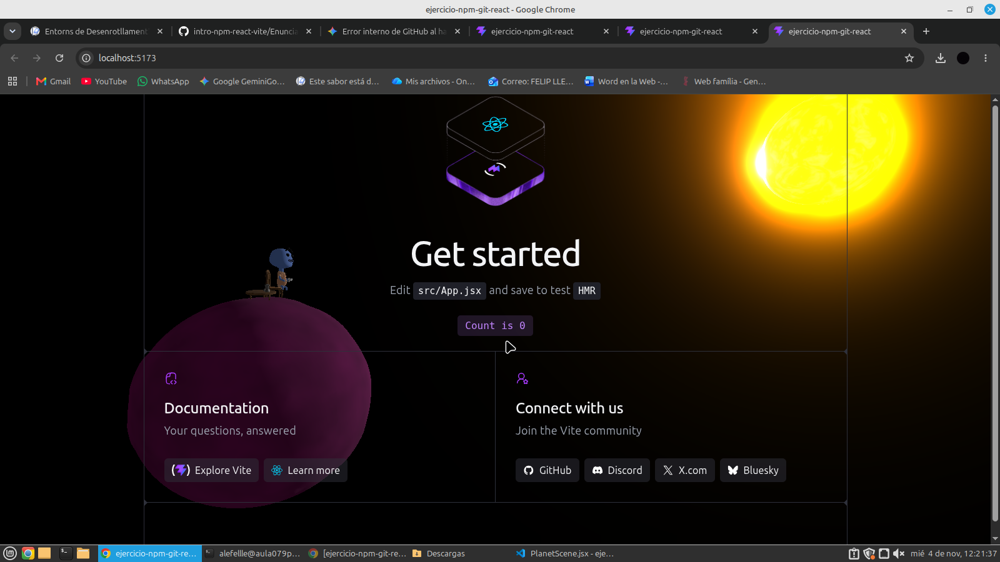

## Imagen de las actividades 

## Respuesta de la pregunta 

Si la carpeta node_modules/ está excluida, ¿borrar una dependencia hace alguna acción sobre el repositorio? ¿Cuál?

- No hace ningun cambio sobre ningun repositorio si esta bien excluido ,ninguno ya que no hace nada 

https://alefellle.github.io/Web-desplegada/